<div align="center">

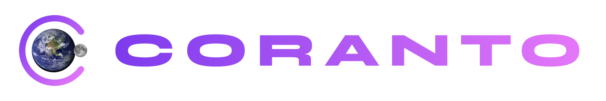


<a href="LICENSE"></a>
<br/>


</div>

---

<p align="center">
  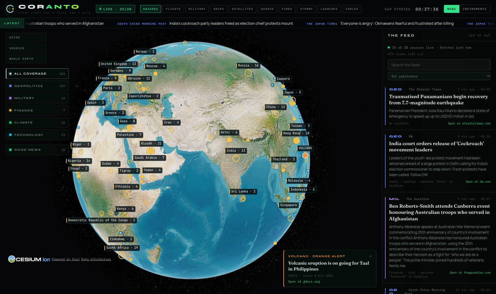
</p>

<p align="center"><em>569 current stories from 25 live sources, pinned to the places they name, with an erupting volcano selected from the hazards layer. Every card is the publisher's own headline and opens the original.</em></p>

<p align="center">
  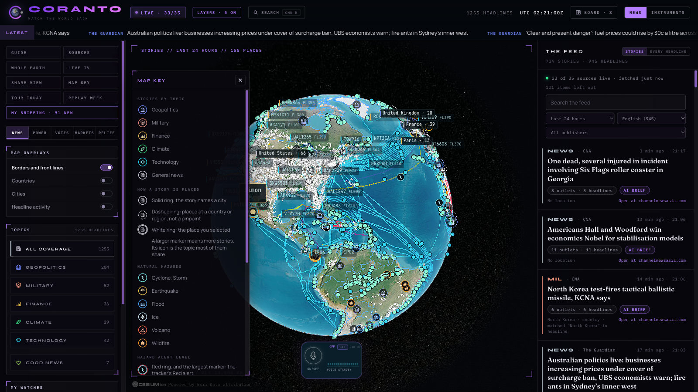
</p>
<p align="center"><em>Every marker is an icon: the topic most stories at a place share, or the kind of hazard. MAP KEY explains whatever is on the globe right now.</em></p>

<table>
<tr>
<td width="50%">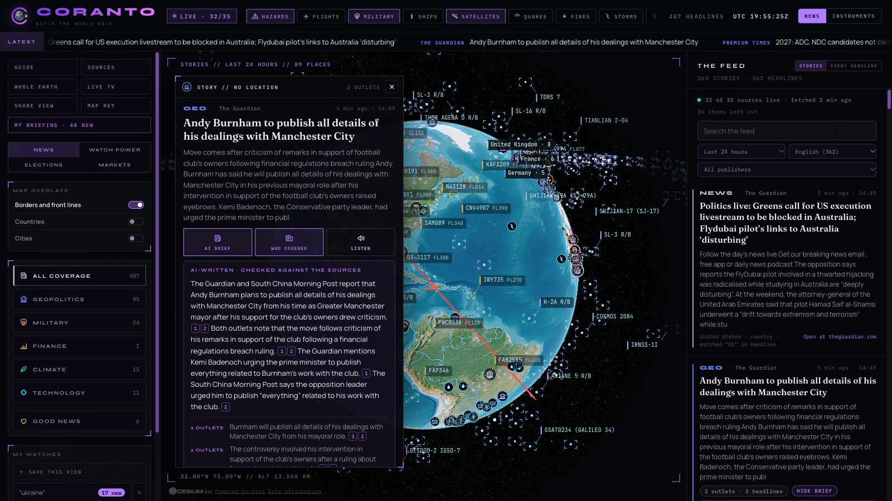</td>
<td width="50%">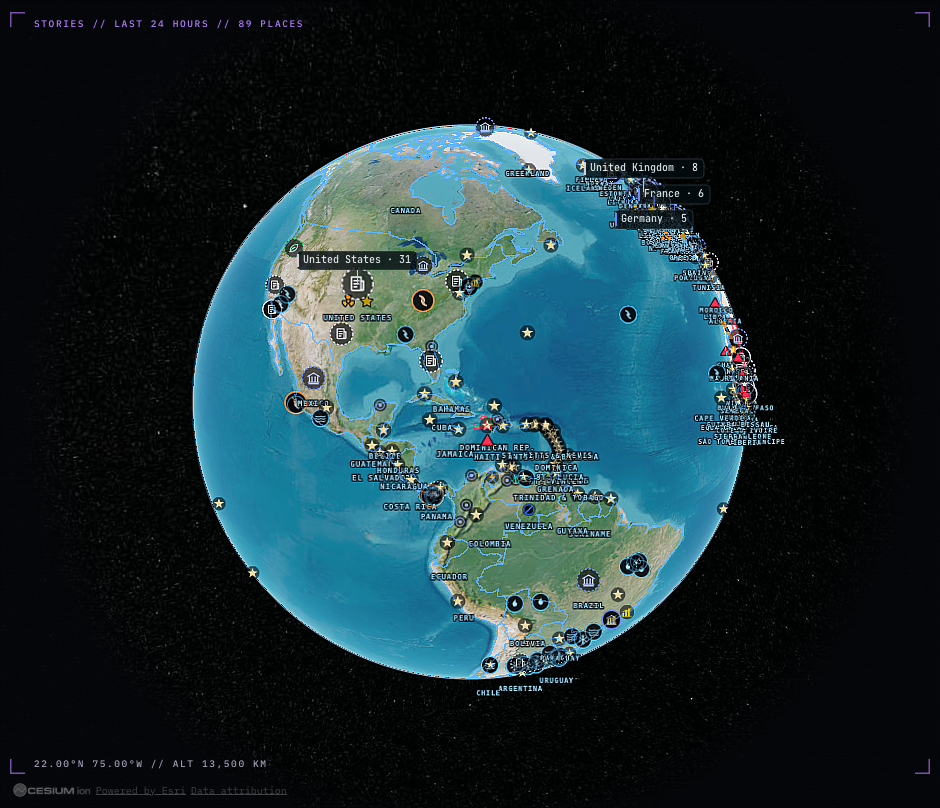</td>
</tr>
<tr>
<td><em>Stories open in the app: headline, summary, where it was placed, and tools for a checked AI brief, who covered it and more. The publisher's link stays inside.</em></td>
<td><em>AUSPEX's atlas: borders and front lines, every country with its status marks, and a thousand cities with an icon for what each is known as.</em></td>
</tr>
</table>

<p align="center">
  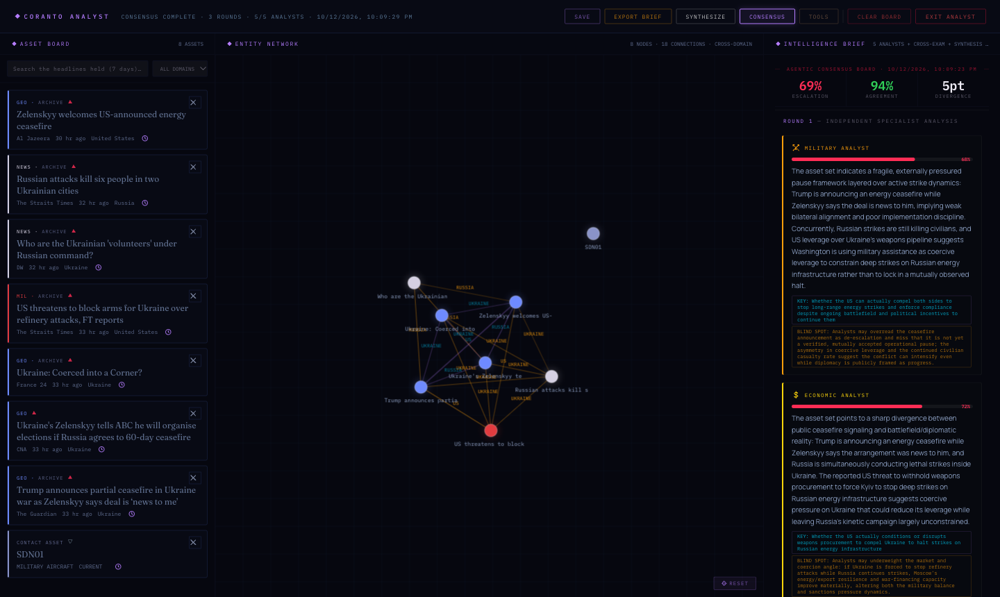
</p>
<p align="center"><em>The analyst board, brought over whole from AUSPEX: your pins on the left, the names they share drawn as a network, and on the right a consensus run, in which five model analysts score the pins, the two furthest apart cross-examine each other, and a sixth writes the conclusion. It is marked as written by a model.</em></p>

<p align="center">
<a href="#what-this-is">What this is</a> ·
<a href="#why-it-exists">Why it exists</a> ·
<a href="#the-honesty-rules">The honesty rules</a> ·
<a href="#how-to-use-it">How to use it</a> ·
<a href="#quickstart">Quickstart</a> ·
<a href="#sources">Sources</a> ·
<a href="#how-it-is-built">How it is built</a> ·
<a href="#roadmap">Roadmap</a> ·
<a href="#credits">Credits</a>
</p>

---

## What this is

**Coranto is an open-source instrument for staying informed with real, sourced news on a live globe.**

The corantos were the first printed newspapers, in the 1620s. Each item was
headed with the place it came from and the date. Coranto does the same thing
four centuries on: it reads public news feeds, pins each story to the place its
own text names, and shows you the publisher, the time and the link. Nothing
else is added.

It is built from two projects:

- **[God's Eye View](https://github.com/bilawalsidhu/gods-eye-view)** supplies
  the engine: a photoreal CesiumJS globe with live aircraft, ships, satellites,
  earthquakes, weather and cameras, all from public sources.
- **[AUSPEX](https://github.com/AllStreets/AUSPEX)** supplies the purpose and
  the look: a calm news instrument that carries good news beside bad and never
  dresses a guess as a fact.

```
  the instrument
  ├─ the feed ......... publisher headlines, newest first, each linked to its source
  ├─ stories .......... the same event across outlets, with how many carried it
  ├─ coverage ......... which regions' outlets carried a story, and which did not
  ├─ figures .......... where outlets give different numbers for the same thing
  ├─ AI brief ......... optional; every sentence cites its sources or is removed
  ├─ search ........... keep only the stories that mention your words
  ├─ watches .......... save a search, place or topic; see what is new since you looked
  ├─ my briefing ...... the latest stories for everything you follow, on one page
  ├─ the globe ........ one marker per place the stories name; rings where approximate
  ├─ source health .... which feeds answered, which did not, and when
  ├─ good news ........ headlines tagged as progress: medical, science, space, humanity
  ├─ hazards .......... cyclones, floods, volcanoes, quakes, fires from GDACS and NASA
  ├─ watch power ...... military aircraft airborne now, mapped military sites, plate readers
  ├─ elections ........ polling days in the next 120 days, with election news beside them
  ├─ markets .......... stock indices, oil, the US 10-year yield, exchange rates and crypto, each with its source and day
  ├─ relief ........... people forced to flee, by country, and disease outbreak notices, from UNHCR and the WHO
  ├─ campaign money ... the biggest US Senate and House fundraisers, from their own FEC filings
  ├─ live TV .......... live news channels from every continent, one click away
  ├─ live layers ...... aircraft, military flights, ships, satellites, storms, launches
  └─ instruments ...... the full control room: tracking, cameras, weather, voice
```

---

## Why it exists

Knowing what is happening in the world, early and across domains, has mostly
belonged to governments and to people who can pay for terminals. The raw
material is public: publisher feeds, aircraft transponders, ship beacons,
orbital elements, seismographs, disaster alerts. What has been missing is one
instrument that gathers it, shows it honestly, and belongs to anyone.

Coranto aims at two things at once:

- **The whole picture stays available.** Every source, every layer, undigested,
  for anyone who wants to look for themselves.
- **You can narrow it to what you care about.** Search, topics, places and
  filters cut the stream down without anything rewriting it for you. Save any
  of them as a watch, and My Briefing gathers the latest for all of them.

---

## The honesty rules

These are enforced in code and by tests that fail the build if they are broken.

| Rule                                                   | What it means                                                                                                                                                                                                                                                                                                                                                                                             |
| ------------------------------------------------------ | --------------------------------------------------------------------------------------------------------------------------------------------------------------------------------------------------------------------------------------------------------------------------------------------------------------------------------------------------------------------------------------------------------- |
| **Source and time**                                    | Every item has a publisher, a working link, the feed's own publish time and the time Coranto fetched it. An item missing any of these is dropped, never patched.                                                                                                                                                                                                                                          |
| **No seeded content**                                  | The code contains no sample or fallback stories. When feeds are down the screen says so and shows nothing in their place.                                                                                                                                                                                                                                                                                 |
| **No randomness in data**                              | A story sits on a real coordinate with its precision shown, or it is not placed. No position is ever nudged.                                                                                                                                                                                                                                                                                              |
| **Inference is labelled**                              | A story's location and topic are worked out from its text. The card shows the exact words that were matched, and topics are marked as automatic tags.                                                                                                                                                                                                                                                     |
| **AI text in the feed is optional, cited and checked** | The feed is the publishers' own words. If you ask for an AI brief of a story or place, every sentence must cite the articles it rests on, and code removes any sentence whose figures or names are not in those articles.                                                                                                                                                                                 |
| **Analysis is kept apart from reporting**              | The analyst board has tools that a model writes freely from what you pinned: consensus, the adversary playbook, the red team brief, the daily brief and the conflict brief. They are opinion, they cite nothing and no code checks them. They appear only on the analyst board, only when you ask, and each one says underneath that a model wrote it. Nothing they produce enters the feed or the globe. |

<table>
<tr>
<td width="50%">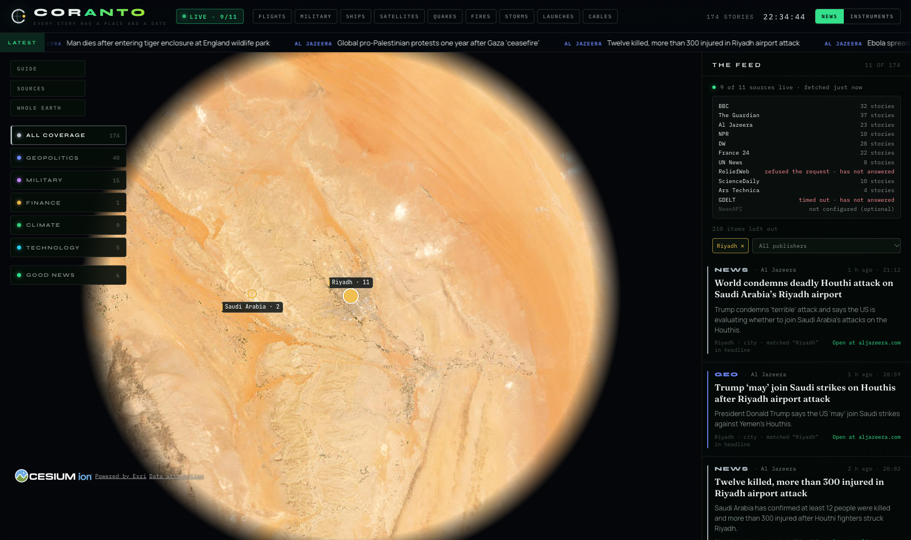</td>
<td width="50%">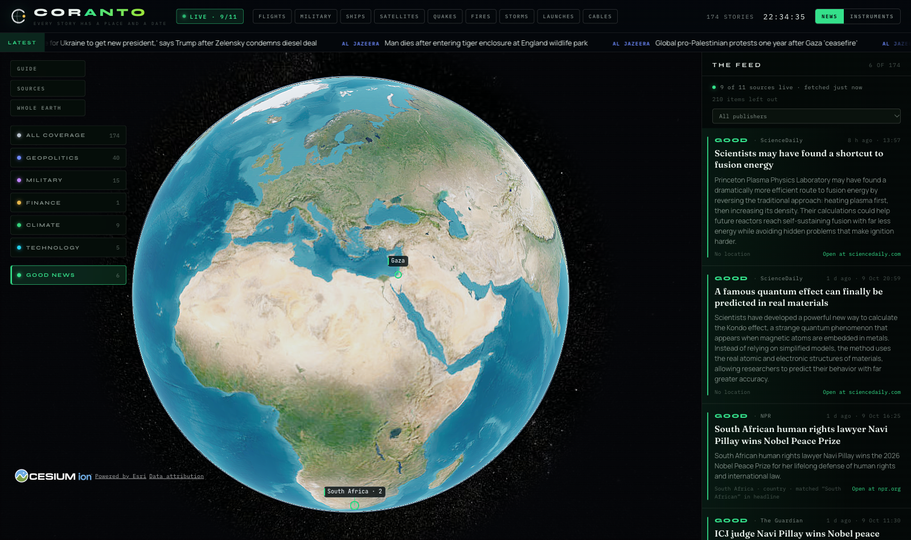</td>
</tr>
<tr>
<td><em>Click <strong>LIVE</strong> and every source drops down with its status: the ones not answering are named first, with the reason. Click it again to close.</em></td>
<td><em>Good news narrows the feed to headlines tagged as progress. The tag is automatic and cautious; it says so on the card.</em></td>
</tr>
</table>

### Stories and checked briefs

<p align="center">
  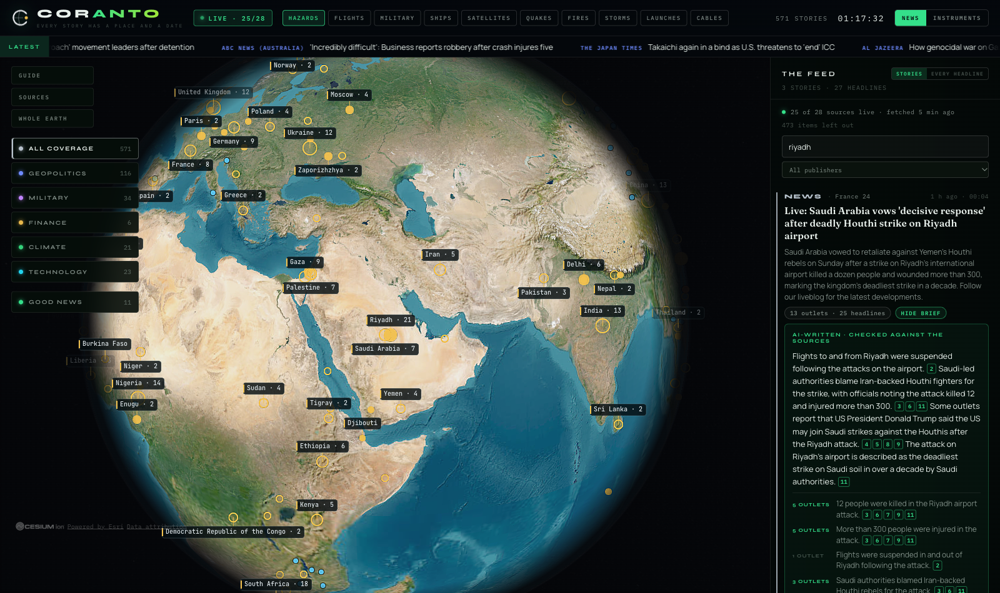
</p>

<p align="center"><em>One story carried by 13 outlets, 25 headlines. The brief's numbered boxes link to the articles each sentence rests on, and each claim shows how many outlets reported it.</em></p>

The feed groups headlines about the same event into one story and counts the
distinct outlets that carried it. Grouping uses shared headline words only,
and you can switch it off with **EVERY HEADLINE**.

For a story with more than one outlet you can ask for an **AI BRIEF**. The
model is given only those outlets' headlines and summaries. Before anything
is shown, code checks each sentence: it must cite sources, and every figure
and name in it must appear in the sources it cites. Sentences that fail are
removed and counted. The check proves a sentence's figures and names come
from the cited articles; it does not prove the outlets are right, which is
why every sentence links to them.

Select a place and **AI BRIEF OF THIS PLACE** does the same for everything
reported from there, using the newest headline of each story. The model is
told to report each event on its own and not to link them.

**TRANSLATE** on a story gives a machine translation into English or ten
other languages, under the original. It is shown only if every number in it
matches the original; code cannot check the wording, and the label says so.

<p align="center">
  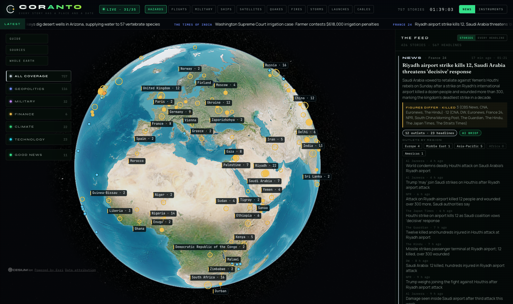
</p>

<p align="center"><em>One story from 12 outlets, 23 headlines. Four outlets' headlines said three were killed and ten said twelve, so the card says the figures differ and who gave which. Below, outlets by region: none of the African outlets read had carried it.</em></p>

Two more things are read straight from the headlines, with no model:

- **Figures that differ.** When outlets in one story give different numbers
  for the same thing, the card says so and names who gave which: for example
  `killed: 15 (France 24) · 20 (CNA)`, or `magnitude: 7.6 (The Hindu) · 7.7
(Euronews, The Guardian)`. Coranto does not pick a winner; later reports
  often carry higher counts.
- **Outlets by region.** Opening a story's outlet list shows how many outlets
  based in Europe, the Middle East, Asia-Pacific, Africa and the Americas
  carried it. A dashed `Africa 0` means the African outlets Coranto reads are
  answering and none has carried it. That is a statement about the outlets
  Coranto reads, not about the whole press of a region.

### The analyst board

**ANALYST** in the header opens a full-screen board, in both views. It is
AUSPEX's analyst board, brought over whole: the same three columns, tools,
wording and prompts, in Coranto's violet.

- **Asset board.** Everything you pinned: stories, countries, cities, and
  aircraft, ships or sites as they were when pinned. Each card carries a
  trend mark (how many other headlines share its place) and a clock that
  opens its timeline. The search above the cards looks through the headlines
  held and pins from there.
- **Entity network.** Pins that name the same listed entity are joined.
  Violet joins pins of one domain, amber joins pins across domains.
- **Intelligence brief.** SYNTHESIZE fills it from the pins by fixed rules,
  with an H, M or L mark on each paragraph for how many live headlines share
  its words. No model is asked.

Worked out in code from the headlines held, with no model: the **narrative
timeline**, the **escalation matrix** (how the pins and the headlines couple
across five domains), **dead reckoning** (countries ranked by how often they
are named, also shown on the globe's country names) and **saved boards**
(kept in this browser).

Written by a model, and labelled so: **CONSENSUS** (five specialist analysts
score the pins in parallel, the highest and lowest cross-examine each other,
and a senior analyst writes the conclusion: eight requests), the **adversary
playbook**, the **red team** brief, the **daily brief** and, on a country
sheet where the atlas marks a conflict, the **conflict brief**. These need
`OPENAI_API_KEY`. The key stays on the server; the route refuses other sites,
is rate limited, caps the reply and never passes on the provider's error text.
Every board output can be exported as an HTML file.

The entity network has depth: drag a dot to move it and it stays where you
put it, drag the background to turn the whole network, scroll to zoom, and
hold Shift to slide it. RESET puts it back.

One thing on the board is style and not fact. Its briefs are stamped `TOP
SECRET`, `NOFORN` and `REL TO FVEY`, as AUSPEX's were. Nothing in Coranto is
classified: every item is from a public source, and the written briefs come
from a model. Settings says so under About. AUSPEX's 30-day history needs a
database, which Coranto does not have yet; the board works from the week of
headlines held.

### DISEASE, and SILENCE in reserve

Two layers of Coranto's own, drawn on the ground itself so that country
names, cities, stories, hazards, aircraft and ships all sit on top.

SILENCE is built but has no button at present: measured this strictly it
was nearly always empty, and an empty layer reads as a broken one. What it
does, for when it returns: it takes the black disc and red ring AUSPEX drew over a hand-kept
list of five places and backs it with measurement. It reads the outage alerts
of [IODA](https://ioda.inetintel.cc.gatech.edu) (Georgia Tech) every ten
minutes. IODA raises an alert for any departure from normal, most of them
slight, so Coranto fills a place only when its latest alert is still open and
the measured level is far below its own recent normal: 50% or more is a
blackout, 30% to 50% a major outage. Routing and active probing count alone;
the two indirect measures count only when a second measure agrees. A whole
country is filled when the country is affected, and only the region when it
is a region. The card gives each measurement and links to IODA. It measures
connectivity and does not say why it fell; a place that has been dark for
longer than IODA's baseline remembers will not show.

**DISEASE** reads the World Health Organization's outbreak notices and the US
CDC's travel health notices. Each country a notice names is covered in
two-degree squares, as the fire layer is, coloured by how the disease
spreads (haemorrhagic fever, mosquito or tick, air, water or food, contact)
and shaded in three steps: the CDC's own level where there is one, a WHO
notice in the last 75 days as the middle step, raised one step when five or
more current headlines name the disease and the country. No source publishes
current case counts by place, so none is shown, and the whole country is
shaded even where a notice covers part of it; the card says both.

### Settings

The gear at the right end of the header opens Settings. Every control saves
the moment it is changed, to this browser only.

<p align="center">
  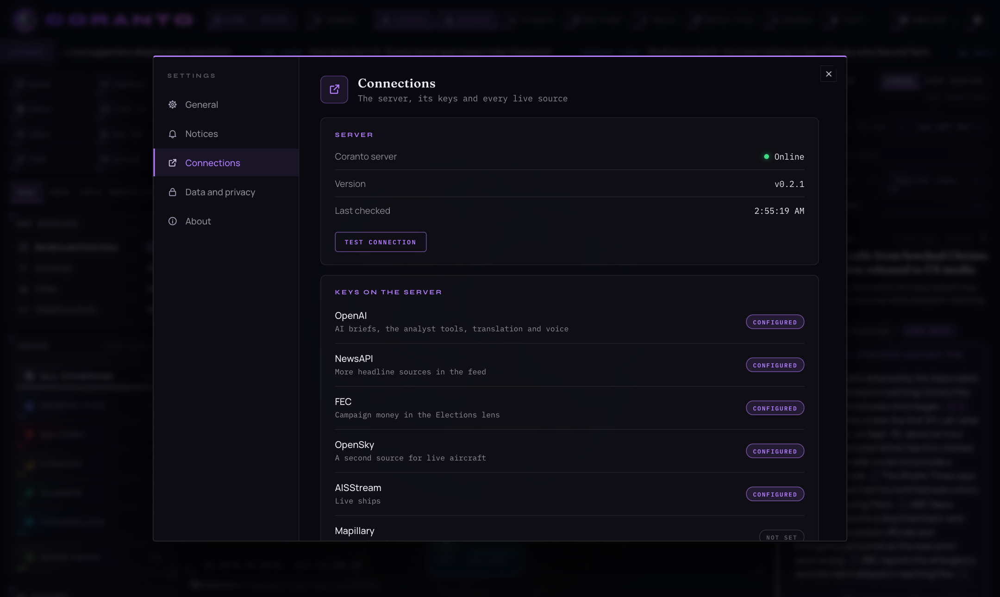
</p>

- **General.** The header layout: one LAYERS list, or SEARCH beside LIVE and
  a button for every layer. The view Coranto opens in, the clock (UTC or
  local) and the headline ticker, and whether the globe is drawn at the
  screen's full resolution.
- **Notices.** Which arrivals raise a notice: your watches, Orange and Red
  disaster alerts, WHO outbreak notices.
- **Connections.** Whether the server is answering, its version, which keys
  are set (never the keys themselves) and every live source with its status.
- **Data and privacy.** What this browser keeps, a one-file export, and
  two-click clearing.
- **About.** Version, licence, the note about the analyst board's stamps,
  the privacy policy, keyboard shortcuts and links.

### Your own feed

<table>
<tr>
<td width="50%">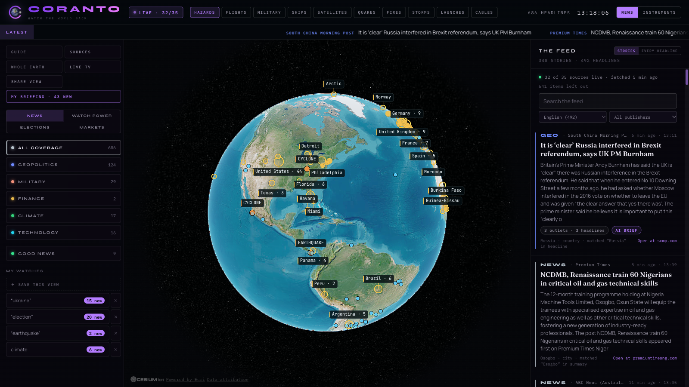</td>
<td width="50%">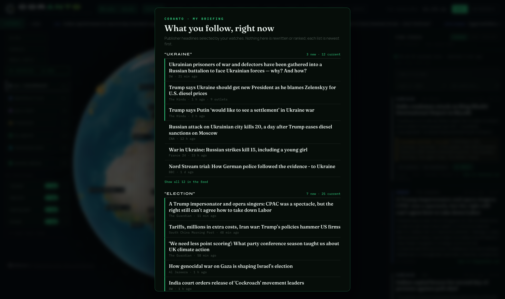</td>
</tr>
<tr>
<td><em>Four watches on the left, each showing how many stories are new since you last looked.</em></td>
<td><em>My Briefing: the latest stories for every watch on one page, newest first, with outlet counts.</em></td>
</tr>
</table>

Hundreds of headlines are too many to read. A **watch** is a search, place,
topic, publisher or any mix of them that you save. Each watch shows a count of
stories that are new since you last opened it, and **MY BRIEFING** lists the
latest stories for all of them on one page.

A watch only selects. The briefing shows the publishers' own headlines,
newest first, with nothing rewritten and nothing ranked by a model. Watches
are stored in your browser and are sent nowhere.

### Watch Power

<p align="center">
  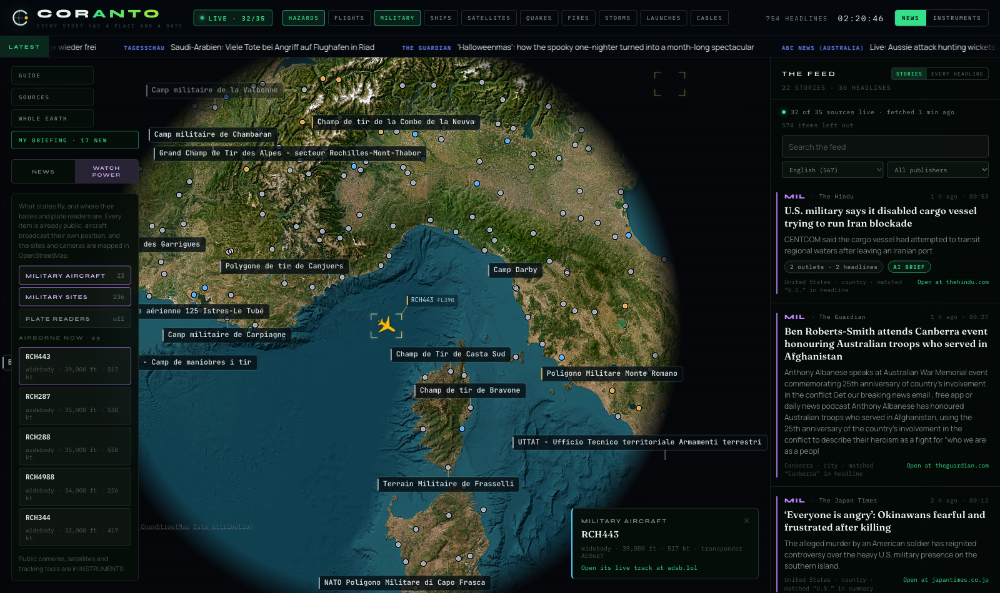
</p>

<p align="center"><em>A military widebody broadcasting the callsign RCH443 over the Ligurian Sea, picked from the list of 23 military aircraft airborne at that moment, with mapped military sites around it and the military news beside it. The card links to the aircraft's live public track.</em></p>

Governments have always been able to watch. The **WATCH POWER** lens turns
the same public signals the other way:

- **Military aircraft** that are broadcasting their own position over ADS-B,
  listed with callsign, type, altitude and speed, each linking to its live
  track at adsb.lol.
- **Military sites** mapped in OpenStreetMap, near wherever you are looking.
- **Plate-reader cameras** mapped in OpenStreetMap, once you zoom into a city.
- **Military news** in the feed alongside.

Everything in the lens is already public. It shows institutions and
equipment. It does not identify or follow individuals, and an aircraft that
is not broadcasting is not shown.

### Elections

<p align="center">
  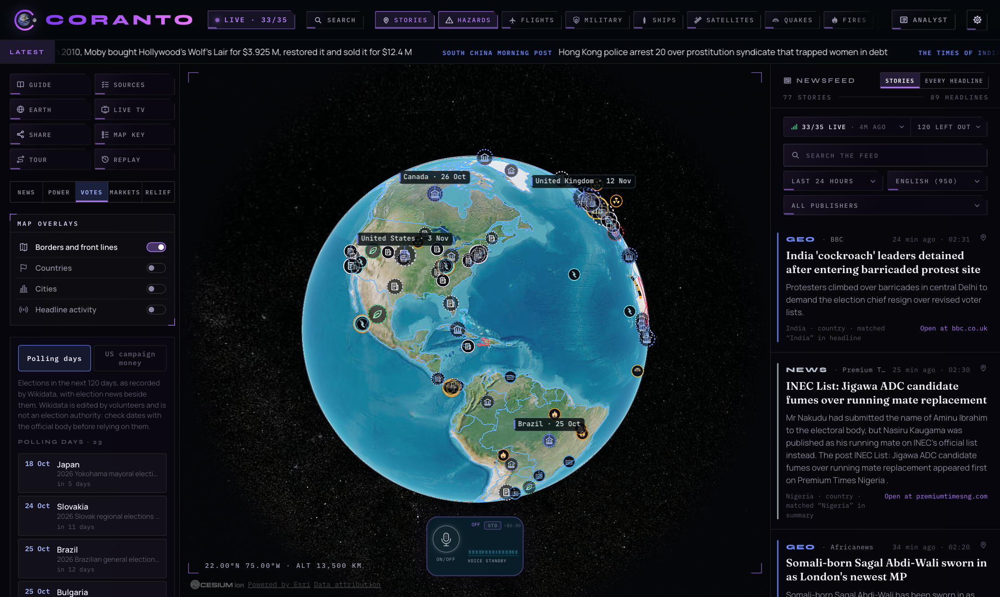
</p>

<p align="center">
  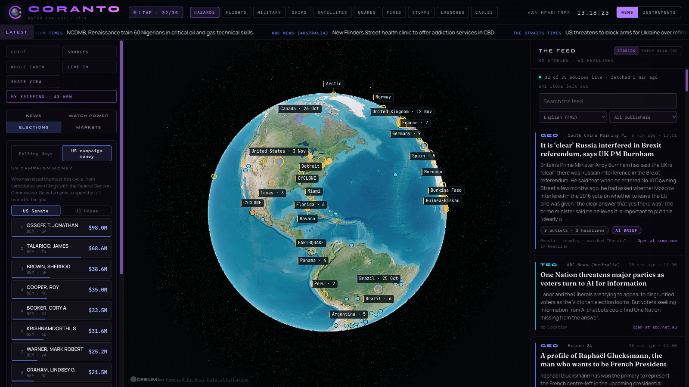
</p>
<p align="center"><em>US campaign money: who has raised the most this cycle, from candidates' own FEC filings. Each name opens the record at fec.gov.</em></p>

<p align="center"><em>Twenty-three polling days in the next 120. Brazil's is selected: the card links to the election's article, and the feed has narrowed to Brazil's election news.</em></p>

The **ELECTIONS** lens lists polling days in the next 120 days, marks them on
the globe, and narrows the feed to election news. Clicking a polling day
flies to the country and shows its election stories.

The calendar comes from **Wikidata**, the public database behind Wikipedia.
It is edited by volunteers and is not an election authority, so the lens says
"as recorded by Wikidata" on every entry and links each to its source. Dates
recorded only to the year, and contests with no set date, are left out. Check
the official election body before relying on a date.

### Markets and live TV

<table>
<tr>
<td width="50%">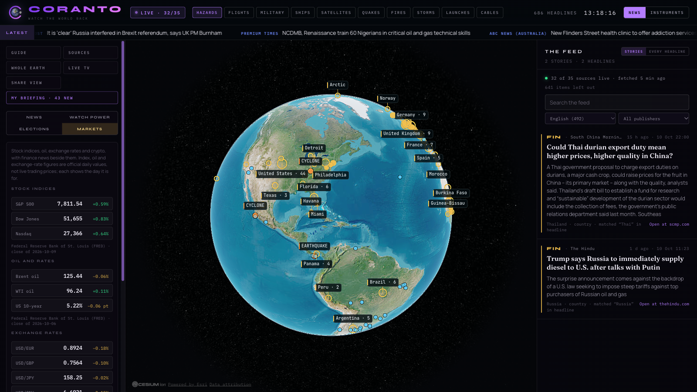</td>
<td width="50%">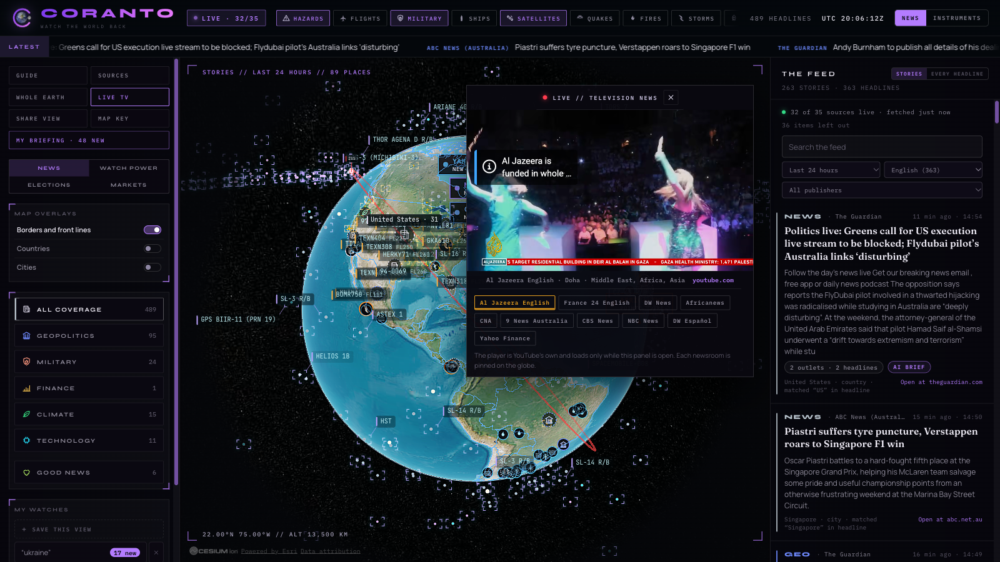</td>
</tr>
<tr>
<td><em>Markets: three stock indices, Brent and WTI oil, the US 10-year yield, eight exchange rates and three crypto prices, each with its source and the day or time the source gave it, beside the finance news.</em></td>
<td><em>Live TV: twelve news channels with a newsroom on every inhabited continent. Ten are AUSPEX's list; Buenos Aires and São Paulo were added for South America.</em></td>
</tr>
</table>

**MARKETS** shows stock indices, oil, the US 10-year yield, exchange rates and
crypto prices beside the finance news. Index, oil and yield figures are daily
closes from the St. Louis Fed; exchange rates are the European Central Bank's
reference rates. Neither is a live trading price, and each shows the day it
is for. Crypto prices come from CoinGecko. Every figure links to its source,
and a change is shown only when the source itself gave an earlier figure to
compare with.

**RELIEF** puts official humanitarian figures beside the humanitarian news:
the countries most people have been forced to flee, from the UN refugee
agency, and the World Health Organization's disease outbreak notices, marked
on the globe and linked to the notice itself. Nothing in it is an estimate of
Coranto's or written by a model.

<p align="center">
  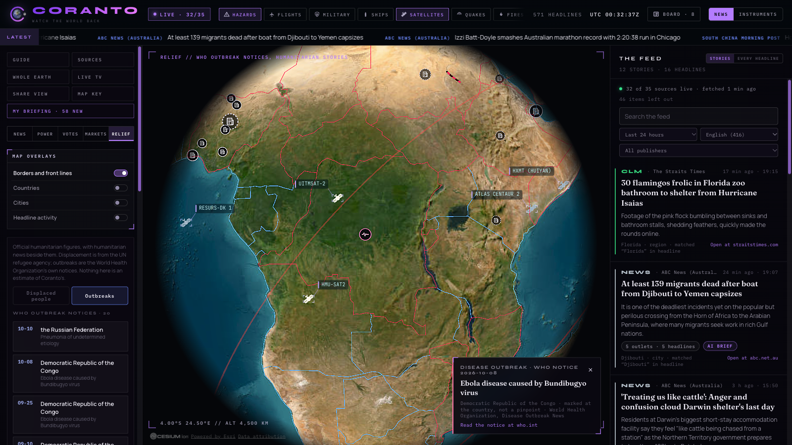
</p>

<p align="center"><em>The Relief lens on outbreaks: the World Health Organization's notice of Ebola in the Democratic Republic of the Congo, marked at the country and linked to who.int, with humanitarian news beside it.</em></p>

**LIVE TV** plays live news channels from Doha, Paris, Berlin, Pointe-Noire,
Singapore, Sydney, New York, Buenos Aires and São Paulo in a panel over the
globe, and pins each
newsroom on the map. The player is YouTube's own, from its no-cookie address;
nothing loads from YouTube until you open the panel, and closing it removes
the player.

---

## How to use it

Coranto has two views, switched at the top right.

### NEWS

| To do this                                                  | Do this                                                                                                                                                                                                                                      |
| ----------------------------------------------------------- | -------------------------------------------------------------------------------------------------------------------------------------------------------------------------------------------------------------------------------------------- |
| Read a story                                                | Click its headline. It opens in the app, with the link to the original at the bottom.                                                                                                                                                        |
| See where stories are                                       | Each marker shows the icon of the topic most stories there share. A solid ring is a city. A dashed ring is a country or region, so the position is approximate. **MAP KEY** explains every symbol.                                           |
| See one place's stories                                     | Click its marker. Clear the filter with the chip at the top of the feed.                                                                                                                                                                     |
| Check why a story is where it is                            | Read the line under the summary, for example `Kyiv · city · matched "Kyiv" in headline`. Click it to fly there.                                                                                                                              |
| See who else reported a story                               | Click the `N outlets` chip on a card to list every outlet's own headline.                                                                                                                                                                    |
| Get a checked summary                                       | Click **AI BRIEF** on a story with several outlets. Needs an OpenAI key.                                                                                                                                                                     |
| Get a checked summary of a place                            | Click a marker with several stories, then **AI BRIEF OF THIS PLACE** above the feed. Needs an OpenAI key.                                                                                                                                    |
| See every headline ungrouped                                | Click **EVERY HEADLINE** at the top of the feed.                                                                                                                                                                                             |
| Translate a story                                           | Open the story, click **TRANSLATE** and pick a language. The original stays above it. Needs an OpenAI key.                                                                                                                                   |
| Read other languages                                        | Pick one from the language menu above the feed. Headlines are shown as published.                                                                                                                                                            |
| Add aircraft, ships, satellites, quakes and other feeds     | Click **LAYERS** at the top. It lists every layer with what it is and a switch.                                                                                                                                                              |
| Watch power                                                 | Click **POWER** on the left. Click any aircraft in the list to fly to it and open its public track.                                                                                                                                          |
| See where people are fleeing and where disease is spreading | Click **RELIEF** on the left. Choose Displaced people or Outbreaks. Click an outbreak to fly to it and open the WHO notice.                                                                                                                  |
| Check the markets                                           | Click **MARKETS** on the left. Click any figure to open its source.                                                                                                                                                                          |
| See who is raising the most money                           | Click **VOTES**, then **US campaign money**. Choose Senate or House. Click a name to open the FEC record.                                                                                                                                    |
| Save a search                                               | Search, pick a topic or select a place, then press **SAVE THIS VIEW** under My Watches. It tells you what it saved.                                                                                                                          |
| Watch a newsroom live                                       | Click **LIVE TV** and pick a channel.                                                                                                                                                                                                        |
| Follow elections                                            | Click **VOTES** on the left. Click a polling day to see that country's election news.                                                                                                                                                        |
| Follow something                                            | Set a search, place or topic, then click **SAVE THIS VIEW**. It appears under MY WATCHES.                                                                                                                                                    |
| Look further back                                           | Use the time range above the feed: last 24 hours, 3 days or 7 days.                                                                                                                                                                          |
| Turn on the atlas                                           | Under **MAP OVERLAYS**, switch on borders, countries or cities. Click a country or city for its card and stories.                                                                                                                            |
| Build a picture                                             | Press the pin on a feed card, or **PIN TO ANALYST** on a story, country, city, aircraft or ship. Open **ANALYST** at the top for the board and its tools.                                                                                    |
| See more of the globe                                       | Move the cursor to the top of either side panel and press the small minimize button on its edge. The panel and the shading around the globe slide away. Move to that edge of the screen and a round arrow brings it back. Coranto remembers. |
| See disease outbreaks                                       | Switch on **DISEASE**. Countries under an official outbreak notice are covered in squares, coloured by how the disease spreads and darker for a higher level.                                                                                |
| Go and look at the Moon                                     | Search for **The Moon**. It is at its true distance and size, with NASA's surface map, and far beyond every satellite drawn. **EARTH** brings you back.                                                                                      |
| Change how it looks                                         | Click the gear at the top right. Settings holds the header layout, the opening view, the clock, notices, connections, your data and About.                                                                                                   |
| Catch up                                                    | Click **MY BRIEFING** for the latest stories on every watch. **Copy as text** puts it on the clipboard with every link.                                                                                                                      |
| Share what you are looking at                               | Click **SHARE**. It copies a link that reopens the same lens, search, topic and place. The link carries the filter only, never news content.                                                                                                 |
| See what an aircraft or ship is                             | Switch on FLIGHTS, MILITARY or SHIPS and click one. A card shows what it is broadcasting and links to a public tracker.                                                                                                                      |
| Search                                                      | Press `/` or type in the box above the feed. Stories must contain every word, in the headline, summary, publisher or place.                                                                                                                  |
| Narrow by topic                                             | Use the list on the left.                                                                                                                                                                                                                    |
| See only good news                                          | Click **GOOD NEWS**.                                                                                                                                                                                                                         |
| Check the sources                                           | Click the **LIVE** badge. It lists every source and whether it answered.                                                                                                                                                                     |
| See everything about one country                            | Search its name and pick **COUNTRY SHEET**, or click the country and choose **Open the country sheet**.                                                                                                                                      |
| See what is near a story                                    | Open the story and click **AROUND HERE**. Rows fly to what they name.                                                                                                                                                                        |
| Be shown the day                                            | Click **TOUR** on the left.                                                                                                                                                                                                                  |
| See what was reported earlier in the week                   | Click **REPLAY** on the left and drag the slider.                                                                                                                                                                                            |
| Be told when something arrives                              | Save a watch. A notice appears when it has more new stories. Switch on **Notify me outside this tab** under My Watches for a browser notification.                                                                                           |
| Use your voice                                              | Click the microphone under the globe and ask. Needs a microphone and an OpenAI key.                                                                                                                                                          |
| Do anything from one box                                    | Press **Ctrl+K** (**Cmd+K** on a Mac) or click **SEARCH**. Type a place, a story, a layer, a channel, a preset or a tool. Each result says what it will do; press Enter to run it.                                                           |
| Add live layers                                             | Click **LAYERS** at the top and switch on any of: hazards, flights, military, ships, satellites, quakes, fires, storms, launches, cables.                                                                                                    |
| Read a hazard                                               | Click its marker. A card shows what it is, the tracker's alert level and a link to the tracker's report. Red means the tracker issued a Red alert, nothing else.                                                                             |
| Get back to the whole globe                                 | Click **EARTH**.                                                                                                                                                                                                                             |
| Use it on a phone                                           | The globe sits above the feed. **MENU** opens the lenses, topics and your watches. The INSTRUMENTS view needs a larger screen.                                                                                                               |
| Move the globe                                              | Drag to spin, scroll to zoom, hold Ctrl or the right button and drag to tilt.                                                                                                                                                                |

The **GUIDE** button in the app shows the same instructions.

### INSTRUMENTS

NEWS is the product; the control room is one of its tools. Open **ANALYST**
and press **INSTRUMENTS** on the board's bar (or search for "Instruments").
Nothing in it is changed. The ringed X at its top left, under the banner,
closes it and returns you to the analyst board.

The full God's Eye View control room in the same frame and style as the news
view, for when you want to go past the headlines. All thirty layers were
switched on and checked; [docs/coranto/INSTRUMENTS.md](docs/coranto/INSTRUMENTS.md)
lists what each shows, where its data comes from, and the key it needs. Click
any aircraft or ship to track it, ride in a cockpit view,
open public cameras, replay weather, change the visual style, talk to the map,
and copy a share link. Its own guide is in
[docs/GODS-EYE-VIEW-README.md](docs/GODS-EYE-VIEW-README.md).

<table>
<tr>
<td width="50%">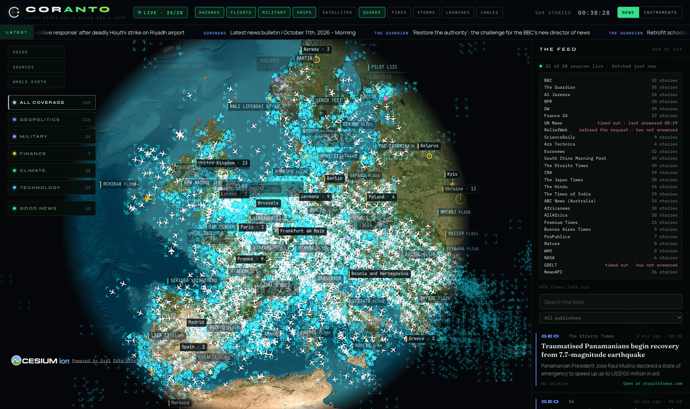</td>
<td width="50%">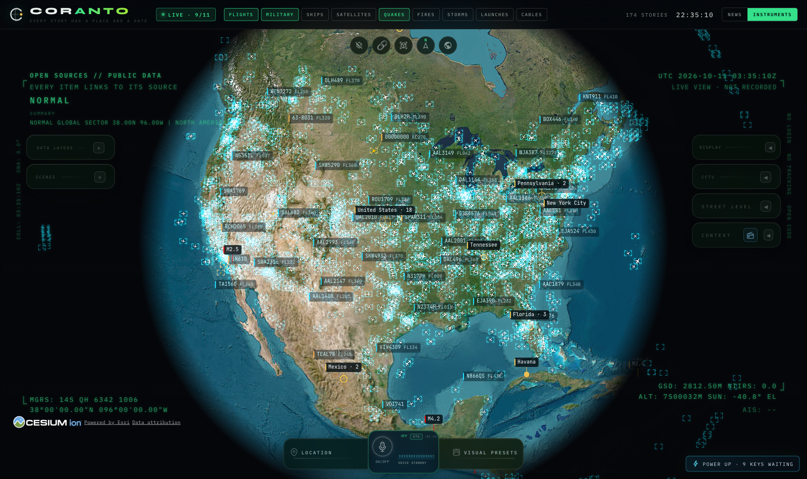</td>
</tr>
<tr>
<td><em>Europe with flights, ships, military aircraft, quakes and hazards on: 5,962 aircraft and 8,143 vessels at the moment of capture. The source list shows 25 of 28 news sources answering.</em></td>
<td><em>Instruments: the same header, ticker and panel style, with the full control room around the globe.</em></td>
</tr>
</table>

---

## Quickstart

You need Node.js 24.14 or later. No account and no API key.

```bash
git clone https://github.com/AllStreets/coranto.git
cd coranto
nvm install 24.14.0 && nvm use 24.14.0
npm ci
npm run dev
```

Open **http://localhost:4173**. The news view loads with headlines on.

### Keys that switch more on

Nothing needs a key. Each of these adds a feed. Put them in a `.env` file in
the project folder (it is gitignored; see `.env.example`), or paste them into
**POWER UP** in the Instruments view.

| Key                                          | What it adds                                                                              |
| -------------------------------------------- | ----------------------------------------------------------------------------------------- |
| `AISSTREAM_API_KEY`                          | Live ships worldwide (AIS)                                                                |
| `OPENSKY_CLIENT_ID`, `OPENSKY_CLIENT_SECRET` | Fuller live aircraft coverage (ADS-B); works without, at a lower rate                     |
| `NEWS_API_KEY`                               | One more news source                                                                      |
| `FIRMS_MAP_KEY`                              | NASA active-fire detections                                                               |
| `CESIUM_ION_TOKEN` or `GOOGLE_MAPS_API_KEY`  | Photoreal 3D cities                                                                       |
| _(none needed)_                              | SILENCE (IODA) and DISEASE (WHO, CDC) need no key                                         |
| `OPENAI_API_KEY`                             | Checked AI briefs, translation, the analyst board's model-written tools and voice control |

---

## Sources

| Region or beat                                 | Sources                                                                                                                | Needs a key   |
| ---------------------------------------------- | ---------------------------------------------------------------------------------------------------------------------- | ------------- |
| Europe                                         | BBC, The Guardian, DW, France 24, Euronews                                                                             | No            |
| Middle East                                    | Al Jazeera                                                                                                             | No            |
| Asia and Pacific                               | South China Morning Post, The Straits Times, CNA, The Japan Times, The Hindu, The Times of India, ABC News (Australia) | No            |
| Africa                                         | Africanews, AllAfrica, Premium Times                                                                                   | No            |
| Americas                                       | NPR, ProPublica, Buenos Aires Times                                                                                    | No            |
| In French, Spanish, German, Portuguese, Arabic | Le Monde, El País, BBC Mundo, Der Spiegel, Tagesschau, G1 Globo, Al Jazeera Arabic                                     | No            |
| International bodies                           | UN News, ReliefWeb, WHO                                                                                                | No            |
| Science and space                              | Nature, ScienceDaily, Ars Technica, NASA                                                                               | No            |
| Indexes                                        | GDELT                                                                                                                  | No            |
| Indexes                                        | NewsAPI                                                                                                                | Yes, optional |

Natural hazards come from **GDACS** (the UN and European Commission's disaster
alert system) and **NASA EONET**. Both are keyless.

Coranto shows the headline, the publisher's own summary and a link. It does not
copy article bodies or images.

Two things to know:

- **Other languages are shown as published.** Seven outlets in French,
  Spanish, German, Portuguese and Arabic are read. The feed shows English by
  default; the language menu shows the rest, untranslated. French, Spanish,
  German, Portuguese and Arabic headlines are placed on the globe using
  those languages' own place names. Topics
  and story grouping work best in English.
- **Some sources will be down.** GDELT rate-limits, and ReliefWeb and UN News
  sometimes refuse or time out. Coranto reports them as down; the feed works
  on the rest.

Stories are filtered before display: adverts, PR copy, entertainment and
anything older than 7 days are left out. The feed shows how many items were
left out and why. The filter lists are in `src/sources/news/junk.js`.

Every other feed (aircraft, ships, satellites, earthquakes, weather, cameras)
is documented in [DATA_SOURCES.md](DATA_SOURCES.md).

---

## How it is built

```
   browser                                        local server (Vite)
┌───────────────────────────────────┐          ┌───────────────────────────────────┐
│ Coranto shell                     │          │ /api/news                         │
│  header · ticker · topics · feed  │  ◄─────  │  reads each source, 8 s deadline  │
│                                   │   JSON   │  drops items with no source/date  │
│ news layer on the Cesium globe    │          │  matches places, tags topics      │
│  one marker per matched place     │          │  reports which sources answered   │
│                                   │          │                                   │
│ God's Eye View engine             │  ◄─────  │ flights · ships · space · weather │
│  layers · tracking · instruments  │          │  (the engine's own providers)     │
└───────────────────────────────────┘          └───────────────────────────────────┘
```

| Part                                                   | Where                                                                                                                                  |
| ------------------------------------------------------ | -------------------------------------------------------------------------------------------------------------------------------------- |
| Record rules, place matching, topic and good-news tags | `src/sources/news/`                                                                                                                    |
| Story grouping and the brief checker                   | `src/sources/news/cluster.js`, `src/sources/news/brief.js`                                                                             |
| News route                                             | `server/providers/news.js`                                                                                                             |
| News globe layer                                       | `src/layers/news/`                                                                                                                     |
| Hazard records, route and layer                        | `src/sources/hazards/`, `server/providers/hazards.js`, `src/layers/hazards/`                                                           |
| Shell and feed                                         | `src/ui/corantoShell.js`, `src/ui/newsPanel.js`                                                                                        |
| Watches, briefing and the lenses                       | `src/ui/watches.js`, `src/ui/corantoPower.js`, `src/ui/corantoElections.js`, `src/ui/corantoMarkets.js`, `src/ui/corantoBroadcasts.js` |
| Market figures                                         | `src/sources/markets/`, `server/providers/markets.js`                                                                                  |
| US campaign money (FEC)                                | `src/sources/campaignFinance/`, `server/providers/campaignFinance.js`, `src/ui/corantoCampaignMoney.js`                                |
| Election calendar                                      | `src/sources/elections/`, `server/providers/elections.js`, `src/layers/elections/`                                                     |
| Look                                                   | `src/ui/styles/coranto.css`, `build/corantoTheme.js`                                                                                   |
| Design spec                                            | `docs/superpowers/specs/`                                                                                                              |

```bash
npm test                 # unit tests, including the honesty gates
npm run qa:news          # browser check of the news view (dev server running)
npm run format:check
npm run check:boundaries
npm run build
```

---

## Roadmap

| Stage                            | Status                                                                                                                                                                                                                                                                                                                             |
| -------------------------------- | ---------------------------------------------------------------------------------------------------------------------------------------------------------------------------------------------------------------------------------------------------------------------------------------------------------------------------------- |
| **1. Foundation and truth feed** | Built: sourced feed from 35 sources, search, globe layer, source health, good-news tag, natural hazards, AUSPEX-style shell                                                                                                                                                                                                        |
| **2. Verification**              | Built: stories grouped across outlets, outlet counts, outlets by region, differing figures, AI briefs checked sentence by sentence, and seven non-English sources                                                                                                                                                                  |
| **3. Lenses and your own feed**  | Built: saved watches, My Briefing, the Power, Votes and Markets lenses, government aircraft, US campaign money, stock indices and oil                                                                                                                                                                                              |
| **4. One product**               | Built: one frame and one look for NEWS and INSTRUMENTS, icons everywhere on the globe and in the interface, a map key, stories that open in the app, live TV in the app, AUSPEX's borders, countries and cities, the analyst board, a week of stories. Next: a Relief lens on official humanitarian data, an archive beyond a week |
| **5. Public site**               | A hosted version anyone can open                                                                                                                                                                                                                                                                                                   |

Coranto currently runs on your own machine. There is no hosted version yet.

---

## Contributing

Issues and pull requests are welcome. Before opening one, run what CI runs:

```bash
npm test                 # unit tests
npm run format:check     # formatting
npm run check:boundaries # module ownership
npm run qa:news          # the honesty gate for the feed
```

One rule is not negotiable: nothing invented. Every item on screen needs a
publisher or source, a link and a time, and a source that is down is named
rather than filled in. A change that adds seeded or simulated content, or puts
model-written text into the feed or onto the globe without a code check, will
not be merged. Model-written analysis belongs on the analyst board, labelled. Security issues go through
the Security tab, not a public issue.

## Credits

Coranto is a fork of **[God's Eye View](https://github.com/bilawalsidhu/gods-eye-view)**
by Bilawal Sidhu (MIT), and carries the news pipeline, palette and principles
of **[AUSPEX](https://github.com/AllStreets/AUSPEX)** by Connor Evans
(Apache-2.0).

Coranto's own code is Apache-2.0: see [LICENSE](LICENSE) and [NOTICE](NOTICE).
God's Eye View's licence and its note on third-party data are kept in
[licenses/gods-eye-view-MIT.txt](licenses/gods-eye-view-MIT.txt). Some bundled datasets, notably
the TeleGeography submarine cable map, are licensed for non-commercial use
only.

Headlines and summaries belong to their publishers.
