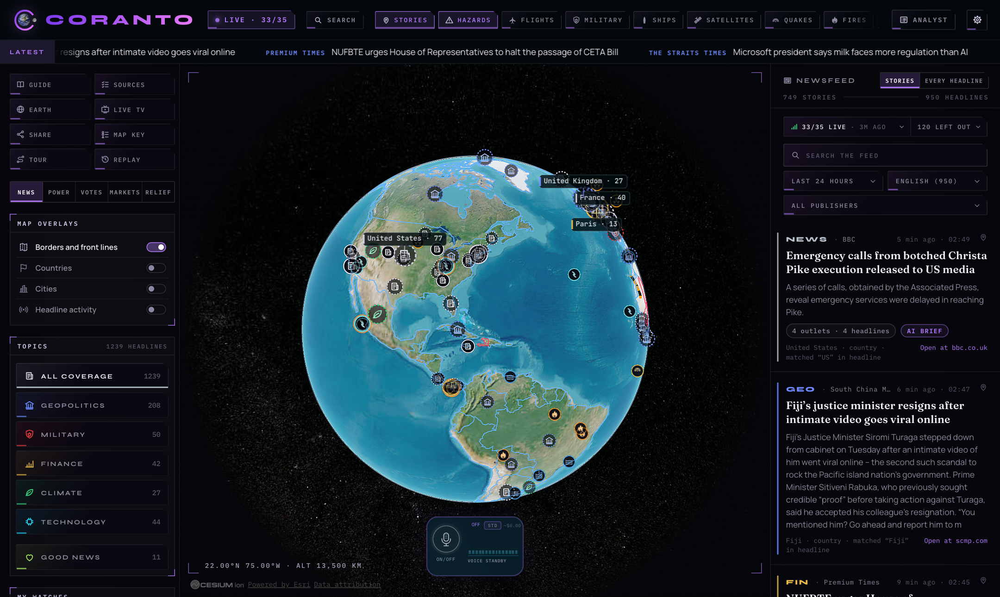
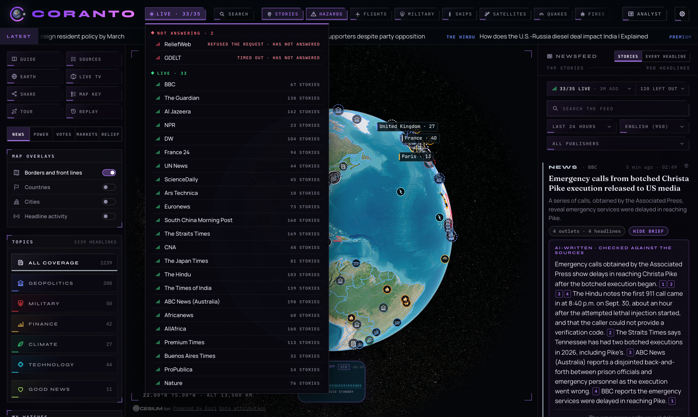
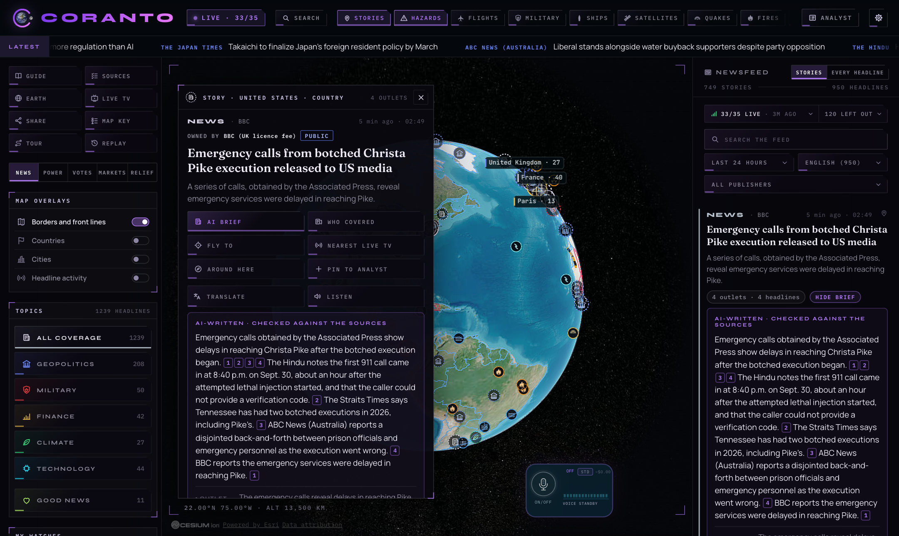
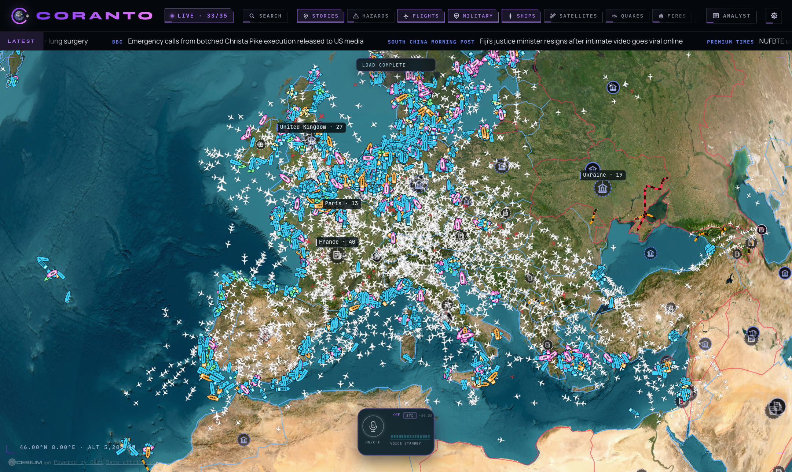
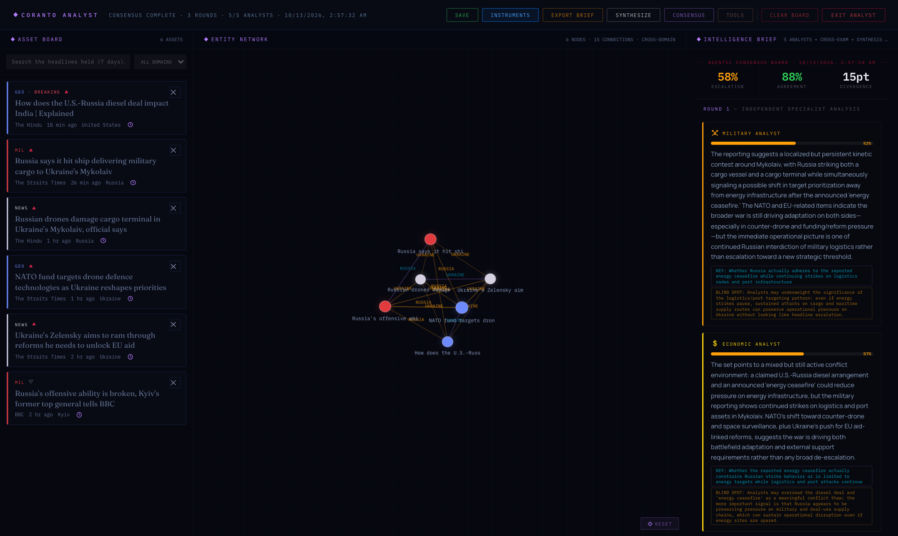
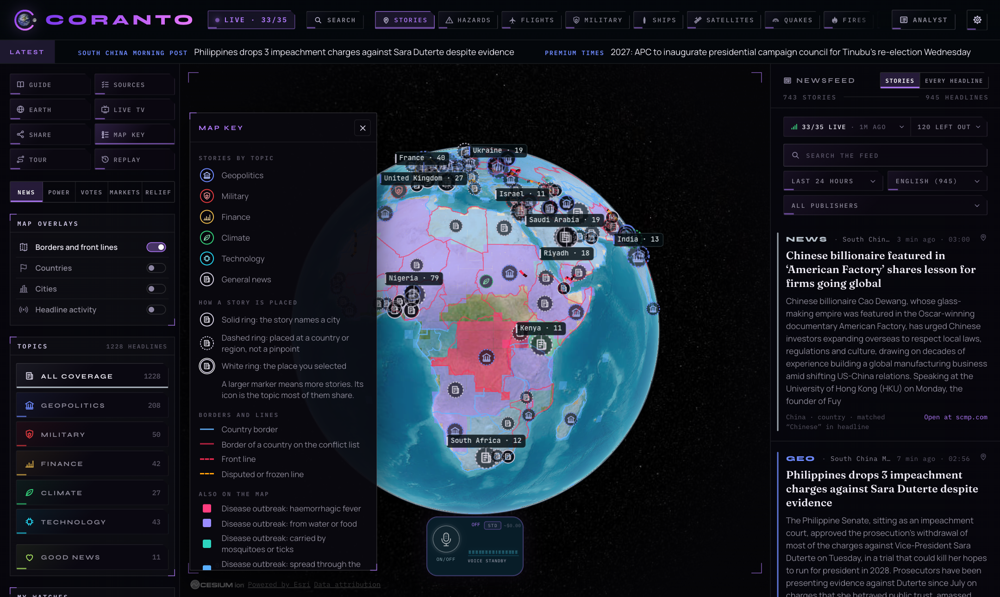
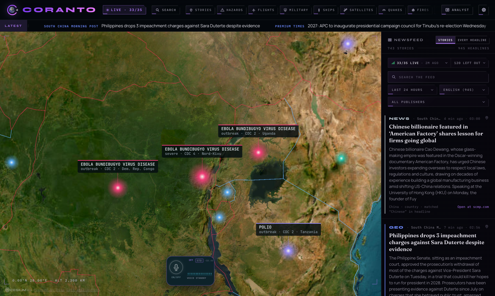
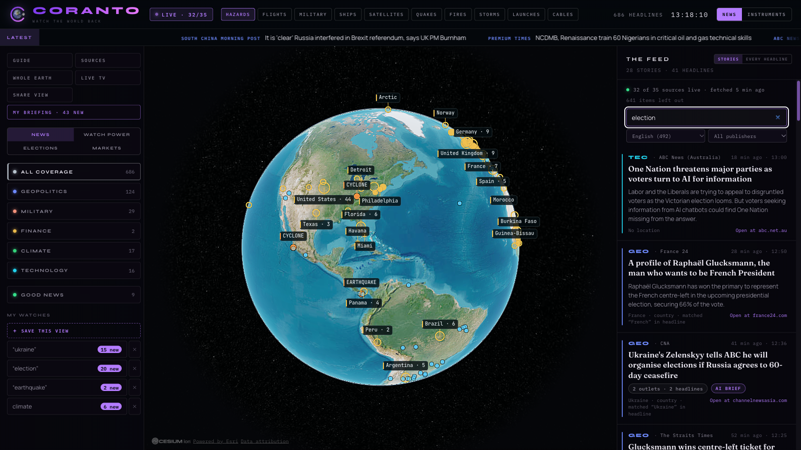
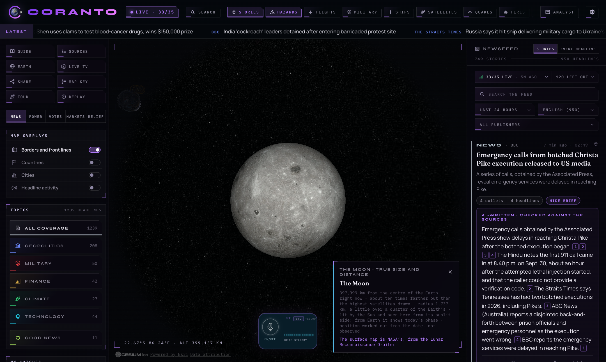

<div align="center">


<p>
  <strong>Real news from named sources, pinned to a live globe.</strong><br/>
  <sub>Every headline links to its publisher &nbsp;·&nbsp; every signal is public &nbsp;·&nbsp; nothing on screen is invented</sub>
</p>

<p>
  <a href="#quickstart"><strong>Quickstart</strong></a> &nbsp;·&nbsp;
  <a href="#a-tour"><strong>Tour</strong></a> &nbsp;·&nbsp;
  <a href="#everything-here-is-real"><strong>The rules</strong></a> &nbsp;·&nbsp;
  <a href="#sources"><strong>Sources</strong></a>
</p>


<a href="LICENSE"></a>
<br/>


</div>

---

<p align="center">
  
</p>
<p align="center"><em>749 current stories from 33 answering sources, each pinned to the place its own text names. Every card is the publisher's headline and opens the original. Nothing on this screen is sample data.</em></p>

<p align="center">
<a href="#everything-here-is-real">Everything here is real</a> ·
<a href="#a-tour">A tour</a> ·
<a href="#what-is-in-it">What is in it</a> ·
<a href="#quickstart">Quickstart</a> ·
<a href="#how-to-use-it">How to use it</a> ·
<a href="#sources">Sources</a> ·
<a href="#how-it-is-built">How it is built</a> ·
<a href="#roadmap">Roadmap</a> ·
<a href="#credits">Credits</a>
</p>

---

## What this is

**Coranto is an open-source instrument for staying informed: real, sourced
news on a live globe, with the public signals of the world around it.**

The corantos were the first printed newspapers, in the 1620s. Each item was
headed with the place it came from and the date. Coranto does the same thing
four centuries on. It reads public news feeds, pins each story to the place
its own text names, and shows you the publisher, the time and the link. Then
it puts the rest of the public record beside the news: aircraft, ships,
satellites, earthquakes, fires, storms, outbreaks, elections, markets.

Knowing what is happening in the world, early and across domains, has mostly
belonged to governments and to people who can pay for terminals. The raw
material is public. Coranto gathers it, shows it honestly, and belongs to
anyone. Hence the slogan: **watch the world back.**

---

## Everything here is real

This is the rule the project is built on, and it is enforced in code and by
tests that fail the build when it is broken.

| Rule                                                   | What it means                                                                                                                                                                                                              |
| ------------------------------------------------------ | -------------------------------------------------------------------------------------------------------------------------------------------------------------------------------------------------------------------------- |
| **Source and time**                                    | Every item has a publisher, a working link, the feed's own publish time and the time Coranto fetched it. An item missing any of these is dropped, never patched.                                                           |
| **No seeded content**                                  | The code contains no sample or fallback stories. When a source is down the screen names it as down and shows nothing in its place.                                                                                         |
| **No randomness in data**                              | A story sits on a real coordinate with its precision shown, or it is not placed. No position is ever nudged.                                                                                                               |
| **Inference is labelled**                              | A story's location and topic are worked out from its text. The card shows the exact words that were matched, and topics are marked as automatic tags.                                                                      |
| **Estimates say so**                                   | A launch's climb to orbit is reconstructed, since no provider publishes the flown track. It is marked ESTIMATED on its card and in the map key.                                                                            |
| **AI text in the feed is optional, cited and checked** | If you ask for an AI brief of a story or place, every sentence must cite the articles it rests on, and code removes any sentence whose figures or names are not in those articles.                                         |
| **Analysis is kept apart from reporting**              | The analyst board has tools that a model writes freely from what you pinned. They appear only there, only when you ask, and each says underneath that a model wrote it. Nothing they produce enters the feed or the globe. |

One thing on screen is style and not fact, and Coranto says so in Settings:
the analyst board stamps its briefs `TOP SECRET`, as its predecessor did.
Nothing here is classified. Every item is from a public source.

<table>
<tr>
<td width="50%"></td>
<td width="50%"></td>
</tr>
<tr>
<td><em>Click <strong>LIVE</strong> and every source drops down with its status. The two not answering are named first, with the reason. A source that is down is never papered over.</em></td>
<td><em>A story from four outlets with its AI brief. Each numbered box links to the article that sentence rests on. Sentences whose figures or names are not in the cited articles are removed before you see it.</em></td>
</tr>
</table>

---

## A tour

### The whole globe, when you want it

<p align="center">
  
</p>
<p align="center"><em>Both side panels put away, with live civil aircraft, military aircraft and ships switched on over Europe. Every mark is a real transponder or beacon broadcasting at that moment.</em></p>

Either side of the news view slides away from a small button on its edge, and
comes back from an arrow at that edge of the screen. The header's layer
buttons switch each live layer with one click.

### The atlas

<p align="center">
  
</p>
<p align="center"><em>Borders and front lines, every country named on a point inside its own outline with its status marks, and a thousand cities with an icon for what each is known as. Story counts sit on the places the stories name.</em></p>

### The analyst board

<p align="center">
  
</p>
<p align="center"><em>Six stories pinned from the feed. In the middle, the entities they share drawn as a network you can turn, zoom and rearrange. On the right, a consensus run: five model analysts score the pins, the two furthest apart cross-examine each other, and a sixth writes the conclusion. It is marked as written by a model.</em></p>

**ANALYST** in the header opens a full-screen board, brought over whole from
AUSPEX in Coranto's violet.

- **Worked out in code, no model:** SYNTHESIZE (a brief from the pins with a
  confidence mark on each paragraph), the entity network, the narrative
  timeline, the escalation matrix, dead reckoning, saved boards.
- **Written by a model, and labelled so:** CONSENSUS, the adversary playbook,
  the red team brief, the daily brief and, on a country sheet where the atlas
  marks a conflict, the conflict brief. These need `OPENAI_API_KEY`. The key
  stays on the server; the route refuses other sites, is rate limited and
  caps the reply.
- **INSTRUMENTS** on the board's bar opens the control room, below.

### Instruments

<p align="center">
  
</p>
<p align="center"><em>The control room: the full God's Eye View engine with its data layers, scenes, cameras, street level, visual presets and voice control, in Coranto's frame. The ringed X at the top left returns to the analyst board.</em></p>

All thirty engine layers were switched on and checked;
[docs/coranto/INSTRUMENTS.md](docs/coranto/INSTRUMENTS.md) lists what each
shows, where its data comes from and the key it needs. The engine's own guide
is in [docs/GODS-EYE-VIEW-README.md](docs/GODS-EYE-VIEW-README.md).

### Disease, drawn like fire

<table>
<tr>
<td width="50%"></td>
<td width="50%"></td>
</tr>
<tr>
<td><em>From afar: countries under a WHO or CDC outbreak notice, covered in squares coloured by how the disease spreads and deeper for a higher level. The map key explains whatever is on the globe.</em></td>
<td><em>Up close the grid gives way to a point on each country or named province, with a card: the disease, the level and the notice it comes from.</em></td>
</tr>
</table>

No source publishes current case counts by place, so none is shown. The level
is the CDC's own, or a WHO notice in the last 75 days, raised one step when
five or more current headlines name the disease and the country.

### Five lenses

<table>
<tr>
<td width="50%"></td>
<td width="50%"></td>
</tr>
<tr>
<td><em><strong>POWER.</strong> Military and government aircraft broadcasting their own position, mapped military sites and plate-reader cameras, beside the military news. It shows institutions and equipment, never individuals.</em></td>
<td><em><strong>VOTES.</strong> Polling days in the next 120 days, as recorded by Wikidata and linked to their source, with US campaign money from candidates' own FEC filings.</em></td>
</tr>
</table>

<table>
<tr>
<td width="50%"></td>
<td width="50%"></td>
</tr>
<tr>
<td><em><strong>MARKETS.</strong> Stock indices, oil, the US 10-year yield, exchange rates and crypto, each with its source and the day the source gave it. None is presented as a live trading price.</em></td>
<td><em><strong>RELIEF.</strong> People forced to flee, by country, from the UN refugee agency, and the World Health Organization's outbreak notices. Nothing in it is an estimate of Coranto's.</em></td>
</tr>
</table>

### One search, the Moon, and Settings

<table>
<tr>
<td width="50%"></td>
<td width="50%"></td>
</tr>
<tr>
<td><em><strong>SEARCH</strong> (Ctrl or Cmd + K) reaches everything from one box: places, stories, layers, lenses, tools, channels. Where a word could mean several things it lists them and says what each does.</em></td>
<td><em>The Moon is where it really is: true distance, true size, with NASA's Lunar Reconnaissance Orbiter surface map. Search for it to fly out.</em></td>
</tr>
</table>

<p align="center">
  
</p>
<p align="center"><em>Settings, behind the gear: header layout, opening view, notices, your data, a privacy policy, and Connections, which shows whether the server is answering, which keys are set (never the keys) and every live source.</em></p>

---

## What is in it

```
  the news
  ├─ newsfeed ......... publisher headlines, newest first, each linked to its source
  ├─ stories .......... the same event across outlets, with how many carried it
  ├─ coverage ......... which regions' outlets carried a story, and which did not
  ├─ figures .......... where outlets give different numbers for the same thing
  ├─ AI brief ......... optional; every sentence cites its sources or is removed
  ├─ translate ........ eleven languages, shown only if every number matches
  ├─ watches .......... save a search, place or topic; see what is new since you looked
  ├─ my briefing ...... the latest for everything you follow, on one page
  ├─ tour · replay .... fly through today's places; step back through the week
  └─ good news ........ headlines tagged as progress, beside everything else

  the globe
  ├─ stories .......... one marker per place the stories name; rings where approximate
  ├─ atlas ............ borders, front lines, countries, a thousand cities
  ├─ hazards .......... cyclones, floods, volcanoes, quakes, fires (GDACS, NASA, USGS)
  ├─ disease .......... official outbreak notices, by country and province (WHO, CDC)
  ├─ live layers ...... aircraft, military flights, ships, satellites, storms, launches, cables
  ├─ country sheet .... one country: its stories, displacement, elections, markets
  └─ the Moon ......... at its true distance and size

  the tools
  ├─ lenses ........... Power, Votes, Markets, Relief
  ├─ live TV .......... twelve news channels, a newsroom on every inhabited continent
  ├─ analyst board .... pins, entity network, synthesis, consensus, timeline, matrix
  ├─ instruments ...... the control room: tracking, cockpit, cameras, weather, scenes
  ├─ voice ............ talk to the map; it can run anything search can
  └─ source health .... which feeds answered, which did not, and when
```

---

## Quickstart

You need Node.js 24.14 or later. No account and no API key.

```bash
git clone https://github.com/AllStreets/coranto.git
cd coranto
nvm install 24.14.0 && nvm use 24.14.0
npm ci
npm run dev
```

Open **http://localhost:4173**. The news view loads with headlines on.

### Keys that switch more on

Nothing needs a key. Each of these adds a feed. Put them in a `.env` file in
the project folder (it is gitignored; see `.env.example`). Settings,
Connections shows which are set.

| Key                                          | What it adds                                                                              |
| -------------------------------------------- | ----------------------------------------------------------------------------------------- |
| `AISSTREAM_API_KEY`                          | Live ships worldwide (AIS)                                                                |
| `OPENSKY_CLIENT_ID`, `OPENSKY_CLIENT_SECRET` | Fuller live aircraft coverage (ADS-B); works without, at a lower rate                     |
| `NEWS_API_KEY`                               | One more news source                                                                      |
| `FEC_API_KEY`                                | US campaign money in the Votes lens                                                       |
| `MAPILLARY_CLIENT_TOKEN`                     | Street-level photographs                                                                  |
| `TOMTOM_API_KEY`                             | Live road traffic                                                                         |
| `CESIUM_ION_TOKEN` or `GOOGLE_MAPS_API_KEY`  | Photoreal 3D cities                                                                       |
| `OPENAI_API_KEY`                             | Checked AI briefs, translation, the analyst board's model-written tools and voice control |

### Putting it on the web

Coranto is a server as well as a page: the server holds the keys and fetches
the feeds, so it needs a host that runs a Node process (the repo carries a
`railway.json` for [Railway](https://railway.com)). A plain static host will
not do.

1. Create a Railway project from this repository. It builds with
   `npm run build` and starts with `npm run start`.
2. Under Variables, paste only the keys you want the public to use through
   your site. A sensible set: `NEWS_API_KEY`, `FEC_API_KEY`,
   `AISSTREAM_API_KEY`, `OPENSKY_CLIENT_ID`, `OPENSKY_CLIENT_SECRET`,
   `OPENAI_API_KEY`, `SUPABASE_URL`, `SUPABASE_SERVICE_ROLE_KEY`, and a
   `CORANTO_VISITOR_SALT` of your own (any long random text).
3. Under Networking, generate a domain. Railway tells the server its own
   name (`RAILWAY_PUBLIC_DOMAIN`), which switches public mode on. For a
   domain of your own, also set `CORANTO_PUBLIC_ORIGIN=https://your.domain`.
   If Railway asks for a port, use the one its deploy log prints
   (`Local: http://localhost:8080/`).
4. Deploy once more after the domain exists. A deployment that started
   before it answers "Blocked request. This host is not allowed", because it
   does not yet know its own name.

In public mode:

- The routes that spend a key answer only pages of the site's own origin.
  Another site's page cannot use them.
- Every visitor is rate limited per minute, and everything a model writes
  (analyst tools, story briefs, translation) counts against one daily
  allowance per visitor, 250,000 tokens unless `CORANTO_AI_DAILY_TOKENS`
  says otherwise. The count needs the Supabase keys; without them only the
  per-minute limits apply.
- Voice control is off and is not shown. A voice session bills by the minute
  and cannot be counted against the allowance.
- The key-setup panel and the local MCP server do not exist there. Keys are
  never sent to the browser, in any mode.

Set a spending limit with each provider as well. The limits above slow abuse;
only the provider can cap a bill.

---

## How to use it

Coranto opens in the news view. The **GUIDE** button in the app shows the
same instructions.

| To do this                | Do this                                                                                                                 |
| ------------------------- | ----------------------------------------------------------------------------------------------------------------------- |
| Read the news             | Scroll the newsfeed on the right. Click a headline to open the story in the app; the publisher's link is at the bottom. |
| See where it is happening | Click a marker on the globe, or the place line on a card.                                                               |
| Check a story             | Open it and press **AI BRIEF** or **WHO COVERED**.                                                                      |
| Check the sources         | Click **LIVE**, or **SOURCES** on the left. Each source is listed with whether it answered.                             |
| Search everything         | **SEARCH**, or Ctrl / Cmd + K.                                                                                          |
| Search the headlines      | Press `/` or type in the box above the feed.                                                                            |
| Switch a live layer       | Use the layer buttons in the header, or the **LAYERS** list. Settings chooses which.                                    |
| See more of the globe     | Move to the top of a side panel and press the minimize button on its edge. An arrow at that screen edge brings it back. |
| Narrow by topic           | Use the list on the left. **GOOD NEWS** shows only headlines tagged as progress.                                        |
| Look further back         | Use the time range above the feed: last 24 hours, 3 days or 7 days.                                                     |
| Follow something          | Set a search, place or topic, then **SAVE THIS VIEW**. **MY BRIEFING** gathers the latest for all your watches.         |
| Be shown the day          | **TOUR** flies through the places with the most stories. **REPLAY** steps back through the week.                        |
| Turn on the atlas         | Under **MAP OVERLAYS**: borders, countries (names coloured by how often the headlines name them), cities.               |
| Open a country            | Click its name with Countries on, then **Open the country sheet**.                                                      |
| Watch a newsroom live     | **LIVE TV**, then pick a channel.                                                                                       |
| Build a picture           | Press the pin on a feed card, or **PIN TO ANALYST** on a story, country, city, aircraft or ship. Open **ANALYST**.      |
| Open the control room     | **ANALYST**, then **INSTRUMENTS**. The ringed X returns you.                                                            |
| Know what a marker means  | **MAP KEY**. It lists only what is on the globe now.                                                                    |
| Share what you see        | **SHARE** copies a link that reopens the same lens, search and place. It carries the filter, never news content.        |
| Talk to it                | The microphone under the globe. It needs `OPENAI_API_KEY`.                                                              |
| Change how it looks       | The gear at the top right.                                                                                              |

---

## Sources

| Region or beat                                 | Sources                                                                                                                | Needs a key   |
| ---------------------------------------------- | ---------------------------------------------------------------------------------------------------------------------- | ------------- |
| Europe                                         | BBC, The Guardian, DW, France 24, Euronews                                                                             | No            |
| Middle East                                    | Al Jazeera                                                                                                             | No            |
| Asia and Pacific                               | South China Morning Post, The Straits Times, CNA, The Japan Times, The Hindu, The Times of India, ABC News (Australia) | No            |
| Africa                                         | Africanews, AllAfrica, Premium Times                                                                                   | No            |
| Americas                                       | NPR, ProPublica, Buenos Aires Times                                                                                    | No            |
| In French, Spanish, German, Portuguese, Arabic | Le Monde, El País, BBC Mundo, Der Spiegel, Tagesschau, G1 Globo, Al Jazeera Arabic                                     | No            |
| International bodies                           | UN News, ReliefWeb, WHO                                                                                                | No            |
| Science and space                              | Nature, ScienceDaily, Ars Technica, NASA                                                                               | No            |
| Indexes                                        | GDELT                                                                                                                  | No            |
| Indexes                                        | NewsAPI                                                                                                                | Yes, optional |

Natural hazards come from **GDACS** (the UN and European Commission's disaster
alert system) and **NASA EONET**. Both are keyless.

Coranto shows the headline, the publisher's own summary and a link. It does not
copy article bodies or images.

Two things to know:

- **Other languages are shown as published.** Seven outlets in French,
  Spanish, German, Portuguese and Arabic are read. The feed shows English by
  default; the language menu shows the rest, untranslated. French, Spanish,
  German, Portuguese and Arabic headlines are placed on the globe using
  those languages' own place names. Topics
  and story grouping work best in English.
- **Some sources will be down.** GDELT rate-limits, and ReliefWeb and UN News
  sometimes refuse or time out. Coranto reports them as down; the feed works
  on the rest.

Stories are filtered before display: adverts, PR copy, entertainment and
anything older than 7 days are left out. The feed shows how many items were
left out and why. The filter lists are in `src/sources/news/junk.js`.

Every other feed (aircraft, ships, satellites, earthquakes, weather, cameras)
is documented in [DATA_SOURCES.md](DATA_SOURCES.md).

---

## How it is built

```
   browser                                        local server (Vite)
┌───────────────────────────────────┐          ┌───────────────────────────────────┐
│ Coranto shell                     │          │ /api/news                         │
│  header · ticker · topics · feed  │  ◄─────  │  reads each source, 8 s deadline  │
│                                   │   JSON   │  drops items with no source/date  │
│ news layer on the Cesium globe    │          │  matches places, tags topics      │
│  one marker per matched place     │          │  reports which sources answered   │
│                                   │          │                                   │
│ God's Eye View engine             │  ◄─────  │ flights · ships · space · weather │
│  layers · tracking · instruments  │          │  (the engine's own providers)     │
└───────────────────────────────────┘          └───────────────────────────────────┘
```

| Part                                                   | Where                                                                                                                                  |
| ------------------------------------------------------ | -------------------------------------------------------------------------------------------------------------------------------------- |
| Record rules, place matching, topic and good-news tags | `src/sources/news/`                                                                                                                    |
| Story grouping and the brief checker                   | `src/sources/news/cluster.js`, `src/sources/news/brief.js`                                                                             |
| News route                                             | `server/providers/news.js`                                                                                                             |
| News globe layer                                       | `src/layers/news/`                                                                                                                     |
| Hazard records, route and layer                        | `src/sources/hazards/`, `server/providers/hazards.js`, `src/layers/hazards/`                                                           |
| Shell and feed                                         | `src/ui/corantoShell.js`, `src/ui/newsPanel.js`                                                                                        |
| Watches, briefing and the lenses                       | `src/ui/watches.js`, `src/ui/corantoPower.js`, `src/ui/corantoElections.js`, `src/ui/corantoMarkets.js`, `src/ui/corantoBroadcasts.js` |
| Market figures                                         | `src/sources/markets/`, `server/providers/markets.js`                                                                                  |
| US campaign money (FEC)                                | `src/sources/campaignFinance/`, `server/providers/campaignFinance.js`, `src/ui/corantoCampaignMoney.js`                                |
| Election calendar                                      | `src/sources/elections/`, `server/providers/elections.js`, `src/layers/elections/`                                                     |
| Look                                                   | `src/ui/styles/coranto.css`, `build/corantoTheme.js`                                                                                   |
| The analyst board and its model route                  | `src/ui/corantoAnalyst.js`, `src/ui/corantoAnalystModel.js`, `server/providers/analystAi.js`                                           |
| Disease and outage layers                              | `src/ui/corantoOverlays.js`, `src/ui/corantoOverlayModel.js`, `src/sources/outbreaks/`, `src/sources/silence/`                         |
| Search, settings, side panels, the Moon                | `src/ui/corantoCommands.js`, `src/ui/corantoSettings.js`, `src/ui/corantoSides.js`, `src/ui/corantoMoon.js`                            |
| Icons (one SVG set, no emoji)                          | `src/data/corantoIcons.js`                                                                                                             |
| Design spec                                            | `docs/superpowers/specs/`                                                                                                              |

```bash
npm test                 # unit tests, including the honesty gates
npm run qa:news          # browser check of the news view (dev server running)
npm run format:check
npm run check:boundaries
npm run build
```

---

## Roadmap

| Stage                            | Status                                                                                                                                                                                                                         |
| -------------------------------- | ------------------------------------------------------------------------------------------------------------------------------------------------------------------------------------------------------------------------------ |
| **1. Foundation and truth feed** | Built: sourced feed from 35 sources, search, globe layer, source health, good-news tag, natural hazards                                                                                                                        |
| **2. Verification**              | Built: stories grouped across outlets, outlets by region, differing figures, AI briefs checked sentence by sentence, translation, seven non-English sources                                                                    |
| **3. Lenses and your own feed**  | Built: saved watches, My Briefing, notices, the Power, Votes, Markets and Relief lenses, government aircraft, campaign money                                                                                                   |
| **4. One product**               | Built: one frame and one look, icons everywhere, stories that open in the app, live TV, the atlas, country sheets, search over everything, the analyst board with Instruments inside it, the Disease layer, the Moon, Settings |
| **5. Depth**                     | Next: an archive beyond a week of stories and search across it, sub-national outbreak data, the internet-outage layer (built, held back until it is useful)                                                                    |
| **6. Public site**               | Built: a public mode for hosting (Railway); the hosted site itself is next                                                                                                                                                     |

Coranto runs on your own machine, and can be put on the web with the steps
under [Putting it on the web](#putting-it-on-the-web).

---

## Contributing

Issues and pull requests are welcome. Before opening one, run what CI runs:

```bash
npm test                 # unit tests
npm run format:check     # formatting
npm run check:boundaries # module ownership
npm run qa:news          # the honesty gate for the feed
```

One rule is not negotiable: nothing invented. Every item on screen needs a
publisher or source, a link and a time, and a source that is down is named
rather than filled in. A change that adds seeded or simulated content, or puts
model-written text into the feed or onto the globe without a code check, will
not be merged. Model-written analysis belongs on the analyst board, labelled. Security issues go through
the Security tab, not a public issue.

## Credits

Coranto is a fork of **[God's Eye View](https://github.com/bilawalsidhu/gods-eye-view)**
by Bilawal Sidhu (MIT), and carries the news pipeline, palette and principles
of **[AUSPEX](https://github.com/AllStreets/AUSPEX)** by Connor Evans
(Apache-2.0).

Coranto's own code is Apache-2.0: see [LICENSE](LICENSE) and [NOTICE](NOTICE).
God's Eye View's licence and its note on third-party data are kept in
[licenses/gods-eye-view-MIT.txt](licenses/gods-eye-view-MIT.txt). Some bundled datasets, notably
the TeleGeography submarine cable map, are licensed for non-commercial use
only.

Headlines and summaries belong to their publishers.
